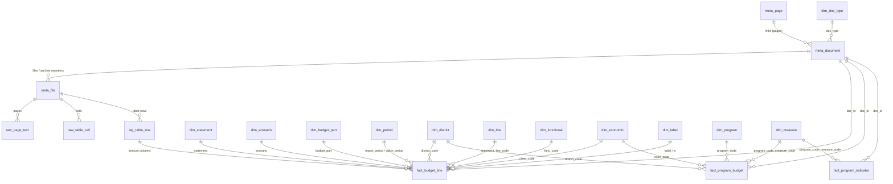

# Database

**English** | [Հայերեն](../hy/database.md) | [Русский](../ru/database.md)

`data/yerevan_budget.duckdb` is a [DuckDB](https://duckdb.org) database built from scratch by
`python -m yerevan_budget build`. All tables and columns have descriptions stored in the database
(`COMMENT ON`, see `duckdb_tables()` / `duckdb_columns()`); the generated list is in
[data_dictionary.md](../data_dictionary.md).

## Principles

* **Lossless.** Every page text (`raw_page_text`) and every table / spreadsheet cell (`raw_table_cell`) of every
  parsed file is stored, so anything the parsers do not interpret is still searchable and checkable.
* **Staging before facts.** Every recognised logical row of a budget table is in `stg_table_row` with its codes,
  name and the raw text of its amount cells and column headers; the facts are derived from it.
* **One long fact table** for all the standard forms (`fact_budget_line`): a row per table row × amount column,
  with the meaning of the column in explicit attributes (`scenario`, `value_year`, `value_period`, `budget_part`).
  Wide views (`v_execution`, `v_budget_approved`, …) pivot it for everyday use.
* **Codes in facts, names in nine languages.** The Armenian name of every row is kept as printed (`label_hy`,
  without the formulas); its English, Russian, French, Spanish, Portuguese, German, Arabic and Persian names
  (`label_en` … `label_fa`) come from the dictionaries (`dim_label`, `dim_translation`), with a fallback to the
  name of the row's code (`dim_functional`, `dim_economic`, `dim_line`). See [translations.md](translations.md).
* **Provenance on every row:** `doc_id`, `file_id`, `page`, `seq` lead back to the document, the file in the archive,
  the page and the row.
* **Primary documents.** Several documents can cover the same type / year / period (the same file under two URLs,
  a re-published report). `meta_document.is_primary` marks the one used by the views; `fact_*` tables keep all.
* **Units:** thousand AMD (`*_kamd`), as in the documents.

## Schema



## Tables

| table | contents |
|---|---|
| `meta_page` | crawled pages of the Finance section |
| `meta_document` | every document (core and institutional): URL, title in hy and its translations (`title_<lang>`), type, year, period, size, hash, primary flag |
| `meta_file` | files of the core documents and members of their archives: format, pages, legacy-font conversions, parsing statistics |
| `dim_doc_type`, `dim_period`, `dim_statement`, `dim_scenario`, `dim_budget_part` | reference lists with names in hy and every translation language |
| `dim_district` | the Municipality and the 12 administrative districts of Yerevan |
| `dim_functional` | functional classification codes `SS.G.C` with names |
| `dim_economic` | article codes (economic classification, revenue and financing articles) with names |
| `dim_line` | line numbers of the forms by statement with names |
| `dim_label` | every distinct row name with its translations |
| `dim_translation` | the dictionaries `data/translations/*.csv` |
| `dim_program`, `dim_measure` | programmes and measures of programme budgeting (codes, names, goals, results, descriptions) |
| `stg_table_row` | every logical row of every recognised budget table |
| `fact_budget_line` | all amounts of the standard forms (long form) |
| `fact_program_budget` | programme budget allocations (unit × functional class × programme × measure × article × year) |
| `fact_program_indicator` | performance indicators of the measures and their target values |
| `raw_page_text`, `raw_table_cell` | lossless text and cells |
| `qc_*` | data quality checks ([data_quality.md](data_quality.md)) |

### `fact_budget_line`: the meaning of a row

| column | values |
|---|---|
| `doc_type` | `execution_report`, `budget`, `budget_draft`, `budget_amendment`, `mtef`, `execution_measures` |
| `fiscal_year`, `report_period` | year of the document and, for reports, its period (`Q1`, `H1`, `9M`, `FY`) |
| `statement` | `revenue`, `expenditure_functional`, `expenditure_economic`, `balance`, `financing`, `expenditure_program` |
| `row_type` | `line` in the standard statements; `total` / `functional` / `program` / `economic` in the detailed tables |
| `line_code`, `func_code`, `class_code` | line of the form, functional class `SS.G.C`, article code |
| `program_hy`, `district_code` | detailed tables: the programme an article row belongs to, the unit (district / Municipality) |
| `scenario` | `approved`, `revised`, `actual`, `draft`, `change`, `forecast`, `plan_period` |
| `value_year`, `value_period` | the year and period the amount refers to (cumulative from 1 January) |
| `budget_part` | `total`, `admin` (administrative part), `fund` (fund part) |
| `amount_kamd` | thousand AMD; NULL for `X` (not applicable) |

Totals and subtotals are rows of the forms like any other: to sum amounts, select a level (e.g. the sections
`func_code LIKE '%.0.0'`, or the lines with an article code) instead of summing all rows.

## Views

| view | contents |
|---|---|
| `v_budget_line` | `fact_budget_line` of the primary documents with names in every language (`label_<lang>`, `program_<lang>`) |
| `v_execution`, `v_execution_annual` | execution reports: approved / revised / actual × total / admin / fund per line |
| `v_budget_approved` | the budget approved by the council (appendices 1–5) |
| `v_budget_program` | detailed allocation: functional class × programme × economic article, city and districts |
| `v_mtef` | medium-term forecasts by year |
| `v_program_budget` | programme budget with programme / measure / article names in every language |
| `v_summary` | total revenues and expenditures by year: budget, approved, revised, actual |
| `v_document` | documents with type names and titles in every language |

## Example queries

```sql
-- revenues and expenditures by year, billion AMD
SELECT fiscal_year, round(revenue_actual_kamd / 1e6, 1) AS revenue_bn, round(expenditure_actual_kamd / 1e6, 1) AS expenditure_bn
FROM v_summary ORDER BY fiscal_year;

-- execution of the main revenue lines in 2025
SELECT line_code, label_en, approved_total_kamd, actual_total_kamd,
       round(100 * actual_total_kamd / nullif(revised_total_kamd, 0), 1) AS pct_of_revised
FROM v_execution_annual WHERE fiscal_year = 2025 AND statement = 'revenue' AND length(line_code) = 4
ORDER BY line_code;

-- expenditures by functional section and year (actual)
SELECT fiscal_year, func_code, any_value(label_en) AS section, sum(actual_total_kamd) AS actual_kamd
FROM v_execution_annual
WHERE statement = 'expenditure_functional' AND func_code LIKE '%.0.0'
GROUP BY ALL ORDER BY fiscal_year, func_code;

-- the approved budget of every district (appendix 7, totals)
SELECT fiscal_year, district_en, total_kamd FROM v_budget_program
WHERE row_type = 'total' AND appendix = 7 AND doc_type = 'budget' ORDER BY fiscal_year, total_kamd DESC;

-- programme budget 2026: programmes of the Municipality and the districts
SELECT program_code, program_en, sum(amount_kamd) AS kamd FROM v_program_budget
WHERE fiscal_year = 2026 AND doc_type = 'budget_message' AND row_type = 'program' AND district_code IS NULL
GROUP BY ALL ORDER BY kamd DESC;

-- full-text search in all documents
SELECT file_id, page FROM raw_page_text WHERE text ILIKE '%մետրոպոլիտեն%';
```
