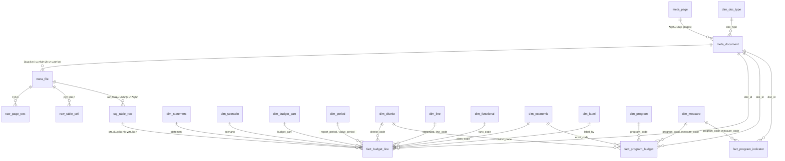

# Տվյալների բազա

[English](../en/database.md) | **Հայերեն** | [Русский](../ru/database.md)

`data/yerevan_budget.duckdb`-ը [DuckDB](https://duckdb.org) տվյալների բազա է, որն ամեն անգամ նորից է կառուցվում
`python -m yerevan_budget build` հրամանով։ Բոլոր աղյուսակներն ու սյուներն ունեն նկարագրություններ, որոնք պահվում են
հենց բազայում (`COMMENT ON`, տե՛ս `duckdb_tables()` / `duckdb_columns()`). ավտոմատ ստեղծված ցուցակը
[data_dictionary.md](../data_dictionary.md)-ում է (անգլերեն)։

## Սկզբունքներ

* **Առանց կորուստների։** Յուրաքանչյուր մշակված ֆայլի յուրաքանչյուր էջի տեքստը (`raw_page_text`) և աղյուսակների ու
  թերթերի յուրաքանչյուր բջիջը (`raw_table_cell`) պահվում են. այն, ինչ վերլուծիչները չեն մեկնաբանում, մնում է
  որոնելի և ստուգելի։
* **Նախ՝ միջանկյալ աղյուսակ, հետո՝ փաստեր։** Բյուջետային աղյուսակի յուրաքանչյուր ճանաչված տրամաբանական տող պահվում
  է `stg_table_row`-ում՝ կոդերով, անվանումով և գումարների բջիջների ու սյուների վերնագրերի սկզբնական տեքստով. փաստերը
  ստացվում են դրանից։
* **Փաստերի մեկ «երկար» աղյուսակ** բոլոր ստանդարտ ձևերի համար (`fact_budget_line`). մեկ տող՝ աղյուսակի տող ×
  գումարների սյուն, սյան իմաստը՝ բացահայտ հատկանիշներում (`scenario`, `value_year`, `value_period`,
  `budget_part`)։ «Լայն» դիտակները (`v_execution`, `v_budget_approved`, …) այն ծավալում են ամենօրյա
  օգտագործման համար։
* **Կոդեր փաստերում, անվանումներ ինը լեզվով։** Յուրաքանչյուր տողի հայերեն անվանումը պահվում է այնպես, ինչպես
  տպված է (`label_hy`, առանց բանաձևերի). անգլերեն, ռուսերեն, ֆրանսերեն, իսպաներեն, պորտուգալերեն, գերմաներեն,
  արաբերեն և պարսկերեն անվանումները (`label_en` … `label_fa`) վերցվում են բառարաններից (`dim_label`,
  `dim_translation`), իսկ դրանց բացակայության դեպքում՝ տողի կոդի անվանումը (`dim_functional`, `dim_economic`,
  `dim_line`)։ Տե՛ս [translations.md](translations.md)։
* **Ծագումը՝ յուրաքանչյուր տողում.** `doc_id`, `file_id`, `page`, `seq` տանում են դեպի փաստաթուղթ, արխիվի ֆայլ,
  էջ և տող։
* **Հիմնական փաստաթղթեր։** Նույն տեսակը / տարին / ժամանակահատվածը կարող են ծածկել մի քանի փաստաթղթեր (նույն ֆայլը
  երկու URL-ով, վերահրապարակված հաշվետվություն)։ `meta_document.is_primary`-ը նշում է այն, որը օգտագործում են
  դիտակները. `fact_*` աղյուսակները պահում են բոլորը։
* **Միավորներ.** հազար դրամ (`*_kamd`), ինչպես փաստաթղթերում։

## Սխեմա



## Աղյուսակներ

| աղյուսակ | բովանդակություն |
|---|---|
| `meta_page` | «Ֆինանսներ» բաժնի շրջանցված էջերը |
| `meta_document` | բոլոր փաստաթղթերը (հիմնական և կազմակերպությունների). URL, անվանում hy և դրա թարգմանությունները (`title_<lang>`), տեսակ, տարի, ժամանակահատված, չափ, հեշ, հիմնական լինելու նշան |
| `meta_file` | հիմնական փաստաթղթերի ֆայլերը և դրանց արխիվների տարրերը. ձևաչափ, էջեր, հին տառատեսակների փոխակերպում, մշակման վիճակագրություն |
| `dim_doc_type`, `dim_period`, `dim_statement`, `dim_scenario`, `dim_budget_part` | տեղեկատուներ՝ hy և թարգմանության յուրաքանչյուր լեզվով անվանումներով |
| `dim_district` | քաղաքապետարանը և Երևանի 12 վարչական շրջանները |
| `dim_functional` | գործառական դասակարգման կոդեր `SS.G.C`՝ անվանումներով |
| `dim_economic` | հոդվածների կոդեր (տնտեսագիտական դասակարգում, եկամուտների և ֆինանսավորման հոդվածներ)՝ անվանումներով |
| `dim_line` | ձևերի տողերի համարները՝ ըստ բաժինների, անվանումներով |
| `dim_label` | տողի յուրաքանչյուր եզակի անվանում՝ թարգմանություններով |
| `dim_translation` | `data/translations/*.csv` բառարանները |
| `dim_program`, `dim_measure` | ծրագրային բյուջետավորման ծրագրեր և միջոցառումներ (կոդեր, անվանումներ, նպատակներ, արդյունքներ, նկարագրություններ) |
| `stg_table_row` | յուրաքանչյուր ճանաչված բյուջետային աղյուսակի յուրաքանչյուր տրամաբանական տող |
| `fact_budget_line` | ստանդարտ ձևերի բոլոր գումարները («երկար» ձև) |
| `fact_program_budget` | ծրագրային բյուջեի բաշխում (ստորաբաժանում × գործառական դաս × ծրագիր × միջոցառում × հոդված × տարի) |
| `fact_program_indicator` | միջոցառումների արդյունքային ցուցանիշները և թիրախային արժեքները |
| `raw_page_text`, `raw_table_cell` | տեքստ և բջիջներ՝ առանց կորուստների |
| `qc_*` | որակի ստուգումներ ([data_quality.md](data_quality.md)) |

### `fact_budget_line`. տողի իմաստը

| սյուն | արժեքներ |
|---|---|
| `doc_type` | `execution_report`, `budget`, `budget_draft`, `budget_amendment`, `mtef`, `execution_measures` |
| `fiscal_year`, `report_period` | փաստաթղթի տարին և, հաշվետվությունների համար, ժամանակահատվածը (`Q1`, `H1`, `9M`, `FY`) |
| `statement` | `revenue`, `expenditure_functional`, `expenditure_economic`, `balance`, `financing`, `expenditure_program` |
| `row_type` | ստանդարտ բաժիններում՝ `line`. մանրամասն աղյուսակներում՝ `total` / `functional` / `program` / `economic` |
| `line_code`, `func_code`, `class_code` | ձևի տող, գործառական դաս `SS.G.C`, հոդվածի կոդ |
| `program_hy`, `district_code` | մանրամասն աղյուսակներ. ծրագիրը, որին պատկանում է հոդվածի տողը. ստորաբաժանումը (վարչական շրջան / քաղաքապետարան) |
| `scenario` | `approved`, `revised`, `actual`, `draft`, `change`, `forecast`, `plan_period` |
| `value_year`, `value_period` | տարին և ժամանակահատվածը, որին վերաբերում է գումարը (հունվարի 1-ից աճողական) |
| `budget_part` | `total`, `admin` (վարչական մաս), `fund` (ֆոնդային մաս) |
| `amount_kamd` | հազար դրամ. NULL՝ `X`-ի (կիրառելի չէ) համար |

Ընդամենը և ենթաընդամենը տողերը ձևերի սովորական տողեր են. գումարելու համար ընտրեք մակարդակ (օրինակ՝ բաժինները
`func_code LIKE '%.0.0'` կամ հոդվածի կոդ ունեցող տողերը), այլ ոչ թե գումարեք բոլոր տողերը։

## Դիտակներ

| դիտակ | բովանդակություն |
|---|---|
| `v_budget_line` | հիմնական փաստաթղթերի `fact_budget_line`-ը՝ յուրաքանչյուր լեզվով անվանումներով (`label_<lang>`, `program_<lang>`) |
| `v_execution`, `v_execution_annual` | կատարման հաշվետվություններ. հաստատված / ճշտված պլան և փաստացի × ընդամենը / վարչ. / ֆոնդ.՝ ըստ տողերի |
| `v_budget_approved` | ավագանու հաստատած բյուջե (հավելվածներ 1–5) |
| `v_budget_program` | մանրամասն բաշխում. գործառական դաս × ծրագիր × տնտեսագիտական հոդված, քաղաք և վարչական շրջաններ |
| `v_mtef` | միջնաժամկետ կանխատեսումներ՝ ըստ տարիների |
| `v_program_budget` | ծրագրային բյուջե՝ ծրագրերի / միջոցառումների / հոդվածների անվանումներով յուրաքանչյուր լեզվով |
| `v_summary` | եկամուտների և ծախսերի ընդամենը՝ ըստ տարիների. բյուջե, հաստատված, ճշտված, փաստացի |
| `v_document` | փաստաթղթեր՝ տեսակների անվանումներով և վերնագրերով յուրաքանչյուր լեզվով |

## Հարցումների օրինակներ

```sql
-- եկամուտներ և ծախսեր ըստ տարիների, մլրդ դրամ
SELECT fiscal_year, round(revenue_actual_kamd / 1e6, 1) AS revenue_bn, round(expenditure_actual_kamd / 1e6, 1) AS expenditure_bn
FROM v_summary ORDER BY fiscal_year;

-- եկամուտների հիմնական տողերի կատարումը 2025 թվականին
SELECT line_code, label_hy, approved_total_kamd, actual_total_kamd,
       round(100 * actual_total_kamd / nullif(revised_total_kamd, 0), 1) AS pct_of_revised
FROM v_execution_annual WHERE fiscal_year = 2025 AND statement = 'revenue' AND length(line_code) = 4
ORDER BY line_code;

-- ծախսեր ըստ գործառական բաժինների և տարիների (փաստացի)
SELECT fiscal_year, func_code, any_value(label_hy) AS section, sum(actual_total_kamd) AS actual_kamd
FROM v_execution_annual
WHERE statement = 'expenditure_functional' AND func_code LIKE '%.0.0'
GROUP BY ALL ORDER BY fiscal_year, func_code;

-- յուրաքանչյուր վարչական շրջանի հաստատված բյուջեն (7-րդ հավելված, ընդամենը)
SELECT fiscal_year, district_en, total_kamd FROM v_budget_program
WHERE row_type = 'total' AND appendix = 7 AND doc_type = 'budget' ORDER BY fiscal_year, total_kamd DESC;

-- 2026 թվականի ծրագրային բյուջե. ծրագրերը՝ քաղաքի համար
SELECT program_code, program_hy, sum(amount_kamd) AS kamd FROM v_program_budget
WHERE fiscal_year = 2026 AND doc_type = 'budget_message' AND row_type = 'program' AND district_code IS NULL
GROUP BY ALL ORDER BY kamd DESC;

-- ամբողջական տեքստային որոնում բոլոր փաստաթղթերում
SELECT file_id, page FROM raw_page_text WHERE text ILIKE '%մետրոպոլիտեն%';
```
