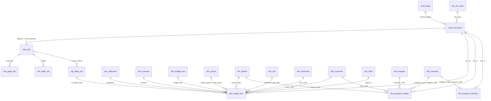

# База данных

[English](../en/database.md) | [Հայերեն](../hy/database.md) | **Русский**

`data/yerevan_budget.duckdb` — база [DuckDB](https://duckdb.org), которая каждый раз собирается заново командой
`python -m yerevan_budget build`. У всех таблиц и столбцов есть описания, хранящиеся в самой базе (`COMMENT ON`,
см. `duckdb_tables()` / `duckdb_columns()`); сгенерированный перечень — в [data_dictionary.md](../data_dictionary.md)
(на английском).

## Принципы

* **Без потерь.** Текст каждой страницы (`raw_page_text`) и каждая ячейка таблиц и листов (`raw_table_cell`) каждого
  разобранного файла сохраняются: всё, что парсеры не интерпретируют, остаётся доступным для поиска и проверки.
* **Сначала staging, потом факты.** Каждая распознанная логическая строка бюджетной таблицы лежит в `stg_table_row`
  с кодами, названием и исходным текстом ячеек сумм и заголовков столбцов; факты выводятся из неё.
* **Одна «длинная» таблица фактов** для всех стандартных форм (`fact_budget_line`): строка на строку таблицы ×
  столбец сумм, смысл столбца — в явных атрибутах (`scenario`, `value_year`, `value_period`, `budget_part`).
  «Широкие» представления (`v_execution`, `v_budget_approved`, …) разворачивают её для повседневной работы.
* **Коды в фактах, названия на девяти языках.** Армянское название каждой строки хранится как напечатано
  (`label_hy`, без формул); английские, русские, французские, испанские, португальские, немецкие, арабские и
  персидские названия (`label_en` … `label_fa`) берутся из словарей (`dim_label`, `dim_translation`), а при их
  отсутствии — название кода строки (`dim_functional`, `dim_economic`, `dim_line`). См.
  [translations.md](translations.md).
* **Происхождение в каждой строке:** `doc_id`, `file_id`, `page`, `seq` ведут к документу, файлу в архиве, странице
  и строке.
* **Основные документы.** Один тип / год / период могут покрывать несколько документов (один файл по двум URL,
  переопубликованный отчёт). `meta_document.is_primary` отмечает тот, что используют представления; таблицы `fact_*`
  хранят всё.
* **Единицы:** тысячи драмов (`*_kamd`), как в документах.

## Схема



## Таблицы

| таблица | содержание |
|---|---|
| `meta_page` | обойдённые страницы раздела «Финансы» |
| `meta_document` | все документы (основные и учреждений): URL, название на hy и его переводы (`title_<lang>`), тип, год, период, размер, хеш, признак основного |
| `meta_file` | файлы основных документов и члены их архивов: формат, страницы, конвертация старых шрифтов, статистика разбора |
| `dim_doc_type`, `dim_period`, `dim_statement`, `dim_scenario`, `dim_budget_part` | справочники с названиями на hy и на каждом языке перевода |
| `dim_district` | мэрия и 12 административных районов Еревана |
| `dim_functional` | коды функциональной классификации `SS.G.C` с названиями |
| `dim_economic` | коды статей (экономическая классификация, статьи доходов и финансирования) с названиями |
| `dim_line` | номера строк форм по разделам с названиями |
| `dim_label` | каждое уникальное название строки с переводами |
| `dim_translation` | словари `data/translations/*.csv` |
| `dim_program`, `dim_measure` | программы и мероприятия программного бюджетирования (коды, названия, цели, результаты, описания) |
| `stg_table_row` | каждая логическая строка каждой распознанной бюджетной таблицы |
| `fact_budget_line` | все суммы стандартных форм («длинная» форма) |
| `fact_program_budget` | распределение программного бюджета (подразделение × функц. класс × программа × мероприятие × статья × год) |
| `fact_program_indicator` | показатели результативности мероприятий и их целевые значения |
| `raw_page_text`, `raw_table_cell` | текст и ячейки без потерь |
| `qc_*` | проверки качества ([data_quality.md](data_quality.md)) |

### `fact_budget_line`: смысл строки

| столбец | значения |
|---|---|
| `doc_type` | `execution_report`, `budget`, `budget_draft`, `budget_amendment`, `mtef`, `execution_measures` |
| `fiscal_year`, `report_period` | год документа и для отчётов его период (`Q1`, `H1`, `9M`, `FY`) |
| `statement` | `revenue`, `expenditure_functional`, `expenditure_economic`, `balance`, `financing`, `expenditure_program` |
| `row_type` | `line` в стандартных разделах; `total` / `functional` / `program` / `economic` в детальных таблицах |
| `line_code`, `func_code`, `class_code` | строка формы, функциональный класс `SS.G.C`, код статьи |
| `program_hy`, `district_code` | детальные таблицы: программа, к которой относится строка статьи; подразделение (район / мэрия) |
| `scenario` | `approved`, `revised`, `actual`, `draft`, `change`, `forecast`, `plan_period` |
| `value_year`, `value_period` | год и период, к которым относится сумма (нарастающим итогом с 1 января) |
| `budget_part` | `total`, `admin` (административная часть), `fund` (фондовая часть) |
| `amount_kamd` | тысячи драмов; NULL для `X` (не применяется) |

Итоги и подытоги — такие же строки форм, как остальные: чтобы суммировать, выберите уровень (например, разделы
`func_code LIKE '%.0.0'` или строки с кодом статьи), а не складывайте все строки.

## Представления

| представление | содержание |
|---|---|
| `v_budget_line` | `fact_budget_line` основных документов с названиями на каждом языке (`label_<lang>`, `program_<lang>`) |
| `v_execution`, `v_execution_annual` | отчёты об исполнении: утверждённый / уточнённый план и факт × всего / адм. / фонд. по строкам |
| `v_budget_approved` | бюджет, утверждённый Советом (приложения 1–5) |
| `v_budget_program` | детальное распределение: функц. класс × программа × экон. статья, город и районы |
| `v_mtef` | среднесрочные прогнозы по годам |
| `v_program_budget` | программный бюджет с названиями программ / мероприятий / статей на каждом языке |
| `v_summary` | итоги доходов и расходов по годам: бюджет, утверждено, уточнено, факт |
| `v_document` | документы с названиями типов и заголовками на каждом языке |

## Примеры запросов

```sql
-- доходы и расходы по годам, млрд драмов
SELECT fiscal_year, round(revenue_actual_kamd / 1e6, 1) AS revenue_bn, round(expenditure_actual_kamd / 1e6, 1) AS expenditure_bn
FROM v_summary ORDER BY fiscal_year;

-- исполнение основных строк доходов в 2025 году
SELECT line_code, label_ru, approved_total_kamd, actual_total_kamd,
       round(100 * actual_total_kamd / nullif(revised_total_kamd, 0), 1) AS pct_of_revised
FROM v_execution_annual WHERE fiscal_year = 2025 AND statement = 'revenue' AND length(line_code) = 4
ORDER BY line_code;

-- расходы по функциональным разделам и годам (факт)
SELECT fiscal_year, func_code, any_value(label_ru) AS section, sum(actual_total_kamd) AS actual_kamd
FROM v_execution_annual
WHERE statement = 'expenditure_functional' AND func_code LIKE '%.0.0'
GROUP BY ALL ORDER BY fiscal_year, func_code;

-- утверждённый бюджет каждого района (приложение 7, итоги)
SELECT fiscal_year, district_en, total_kamd FROM v_budget_program
WHERE row_type = 'total' AND appendix = 7 AND doc_type = 'budget' ORDER BY fiscal_year, total_kamd DESC;

-- программный бюджет 2026: программы по городу
SELECT program_code, program_ru, sum(amount_kamd) AS kamd FROM v_program_budget
WHERE fiscal_year = 2026 AND doc_type = 'budget_message' AND row_type = 'program' AND district_code IS NULL
GROUP BY ALL ORDER BY kamd DESC;

-- полнотекстовый поиск по всем документам
SELECT file_id, page FROM raw_page_text WHERE text ILIKE '%մետրոպոլիտեն%';
```
